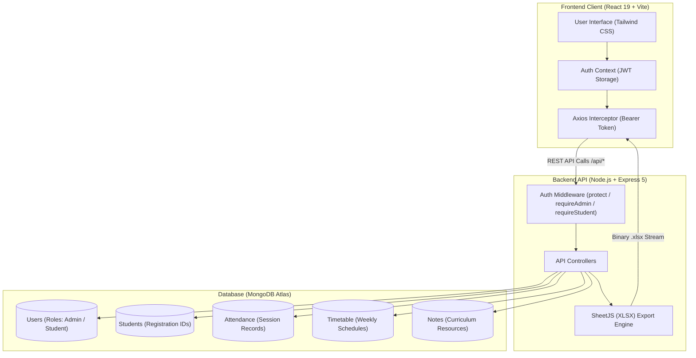
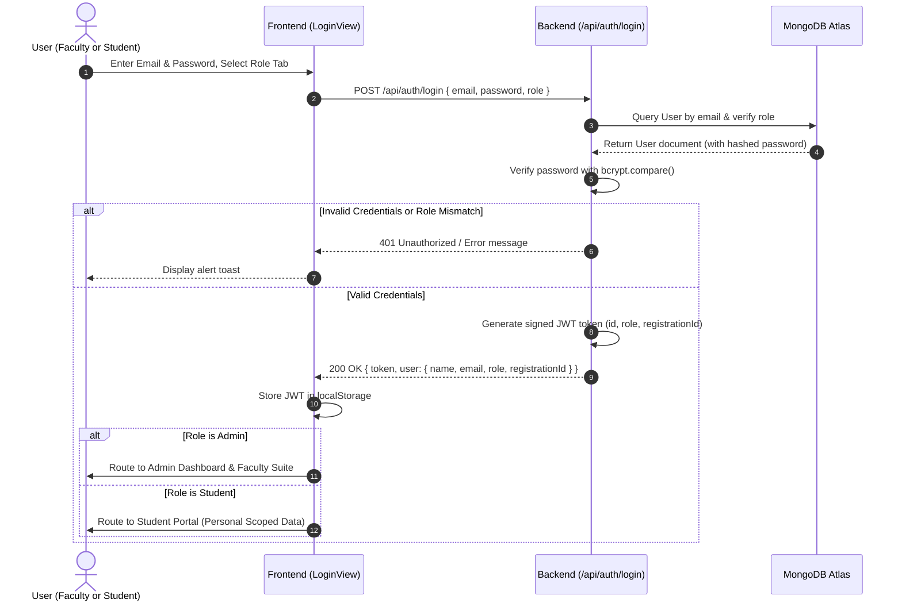

# 🎓 SNIT | Academic Management Portal

A modern, full-stack institutional web portal designed for colleges and universities. Built with the **MERN Stack** (MongoDB, Express.js, React 19, Node.js) and styled with **Tailwind CSS**.

The portal provides a unified academic system featuring dual-role access control for **Faculty / Administrators** and **Students**, comprehensive attendance tracking, lecture scheduling, study notes distribution, and 1-click Excel report generation.

---

## 📌 System Overview

SNIT Portal is structured around role-based workflows that separate administrative capabilities from student self-service:

- **Faculty & Admin Suite:**
  - **Live Dashboard:** Quick overview of daily schedules, active lectures, enrolled students, and cohort attendance rates.
  - **Attendance Management:** Record daily class attendance (Present / Absent) by date, semester, and course.
  - **1-Click Excel Attendance Reports:** Export detailed attendance records directly from MongoDB into Excel (`.xlsx`) format. Supports filtering across past academic years, semesters, departments, and courses.
  - **Student Roster:** Register and manage students with auto-generated unique registration IDs (`STU-...`) and auto-provisioned student accounts.
  - **Timetable & Schedule Planner:** Organize weekly lecture periods, timings, and lecture halls.
  - **Notes & Study Material:** Upload and publish curriculum notes, summaries, and downloadable references.

- **Student Portal:**
  - **Personal Attendance Tracking:** View real-time subject-wise and overall attendance percentage, attended classes, and eligibility status ($\ge 75\%$).
  - **Class Timetable:** Access personalized weekly class schedules with timings and room numbers.
  - **Study Materials & Notes:** Read and download lecture notes shared by faculty members.
  - **Account Security:** Self-service password management with secure Bcrypt hashing.
  - **Data Isolation:** Enforced data privacy ensuring students can only view their own records.

---

## 🏗️ Architecture & Workflows

### 1. System Architecture



---

### 2. Authentication & Role-Based Routing Workflow



---

### 3. Attendance Reporting & Excel Export Workflow

```mermaid
flowchart LR
    A["Admin selects filters<br/>(Year, Semester, Subject)"] --> B["API: GET /api/reports/preview"]
    B --> C["Query MongoDB Attendance & Student"]
    C --> D["Calculate % & Defaulters (<75%)"]
    D --> E["Render Preview Table on Screen"]

    E --> F["Admin clicks 'Download Excel (.xlsx)'"]
    F --> G["API: GET /api/reports/export-excel"]
    G --> H["SheetJS generates Multi-sheet Workbook"]
    H --> I["Sheet 1: Summary<br/>Sheet 2: Session Matrix<br/>Sheet 3: Defaulters Notice<br/>Sheet 4: Sessions Log"]
    I --> J["Stream .xlsx to Browser via Blob Download"]
```



---

## 🛠️ Technology Stack

| Layer | Technologies |
|---|---|
| **Frontend** | React 19, Vite, Tailwind CSS, Lucide React, Axios |
| **Backend** | Node.js, Express.js 5, JSON Web Tokens (JWT), Bcrypt.js, SheetJS (`xlsx`) |
| **Database** | MongoDB Atlas (Cloud Cluster) with Mongoose ODM |
| **Hosting & Cloud** | Vercel (Frontend SPA) + Render (Backend Web Service) |

---

## 📋 API Endpoints Reference

### Authentication & Profiles
- `POST /api/auth/login` — Authenticate faculty admin or student and receive JWT.
- `GET /api/auth/me` — Fetch authenticated user profile.

### Student Management (Admin Only)
- `GET /api/students` — List students (filtered by semester or department).
- `POST /api/students` — Register a student; auto-generates `registrationId` and student login account.
- `PUT /api/students/:id` — Update student profile.
- `DELETE /api/students/:id` — Remove student and associated records.

### Attendance & Reports (Admin Only)
- `GET /api/attendance` — Fetch attendance records for a specific date and course.
- `POST /api/attendance` — Record or upsert attendance for an entire class.
- `GET /api/attendance/summary` — Aggregate overall attendance percentages.
- `GET /api/attendance/dashboard-stats` — Fetch dashboard counts and daily schedules.
- `GET /api/reports/filters` — Get available past years, semesters, and departments from database.
- `GET /api/reports/preview` — Get attendance calculation preview for selected filters.
- `GET /api/reports/export-excel` — Download full Excel `.xlsx` workbook.

### Timetable & Notes (Admin Only)
- `GET /api/timetable` — Fetch weekly lecture schedules.
- `POST /api/timetable` — Add a new timetable entry.
- `DELETE /api/timetable/:id` — Delete a timetable entry.
- `GET /api/notes` — Fetch study materials.
- `POST /api/notes` — Create or update a note.
- `DELETE /api/notes/:id` — Remove a note.

### Student Portal (Student Only)
- `GET /api/student-portal/dashboard` — Fetch personal attendance record, timetable, and notes.
- `POST /api/student-portal/change-password` — Change student login password.

---

## ⚙️ Environment Configuration

To run locally or configure cloud hosting, set the following environment variables:

### Backend (`backend/.env`)
```env
PORT=5000
NODE_ENV=production
MONGO_URI=mongodb+srv://<db_username>:<db_password>@<cluster-address>/college_portal?retryWrites=true&w=majority
JWT_SECRET=your_secure_random_jwt_secret_key
ADMIN_EMAIL=admin@institution.edu
ADMIN_PASSWORD=your_secure_admin_password
FRONTEND_URL=https://your-frontend-domain.vercel.app
```

### Frontend (`frontend/.env`)
```env
VITE_API_URL=https://your-backend-service.onrender.com
```

---

## 💻 Local Development Setup

1. **Clone the repository:**
   ```bash
   git clone https://github.com/Karankumawa/student-attendance-web.git
   cd student-attendance-web
   ```

2. **Install dependencies:**
   ```bash
   npm run install:all
   ```

3. **Start backend server:**
   ```bash
   npm run dev:backend
   ```

4. **Start frontend development server:**
   ```bash
   npm run dev:frontend
   ```

5. **Build for production:**
   ```bash
   npm run build:frontend
   ```

---

## 🔒 Security & Privacy Practices

- **Zero Plain-Text Passwords:** All credentials are encrypted with salted Bcrypt hashing before storage.
- **Strict Role-Based Scoping:** Middleware functions (`requireAdmin`, `requireStudent`) prevent horizontal and vertical privilege escalation.
- **Credential Protection:** Passwords and private API keys are excluded from git history via `.gitignore` and dynamic environment variables.

---

## 📄 License

This project is licensed under the ISC License.
